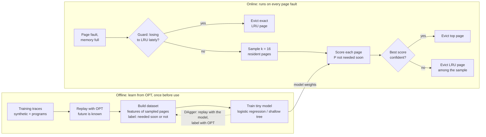
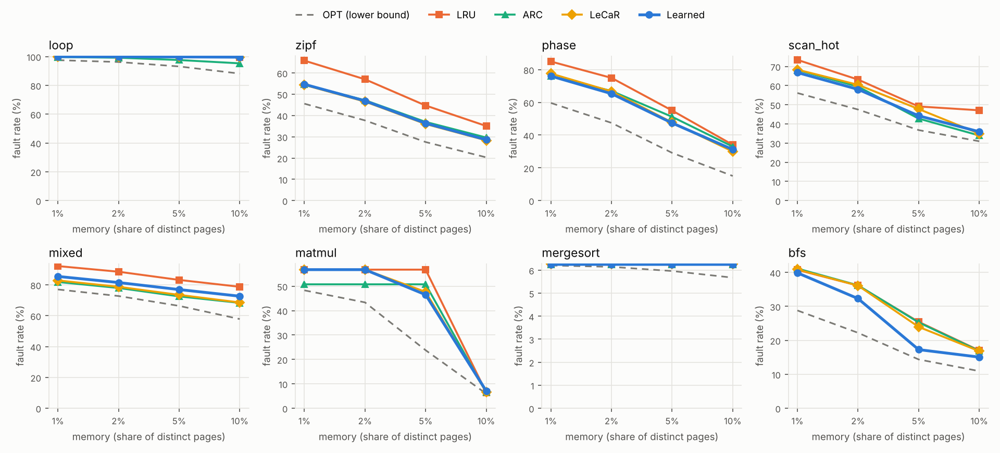
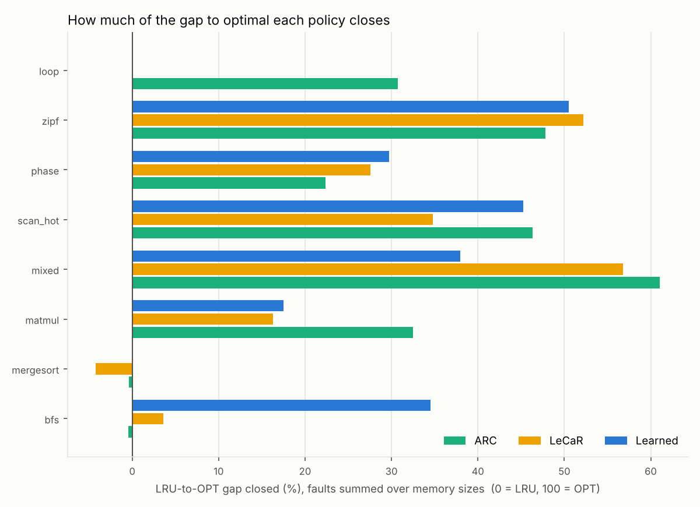
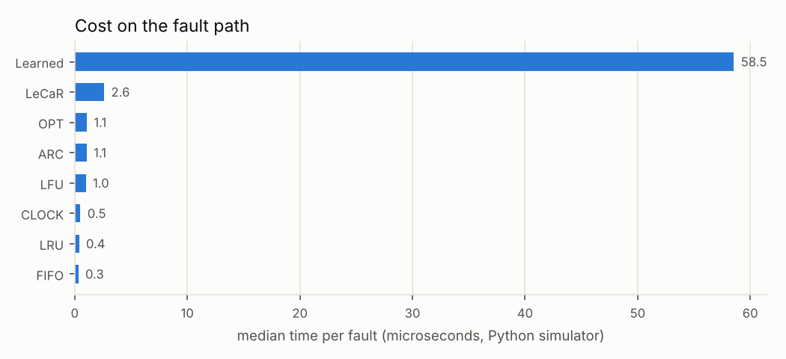
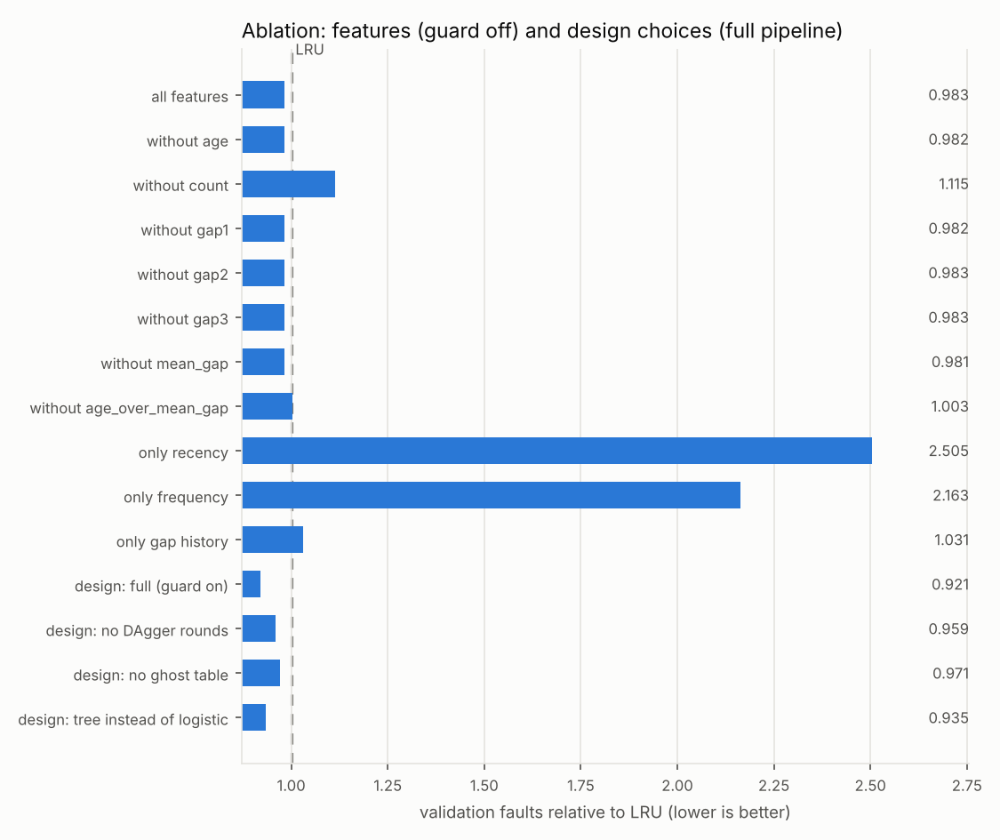
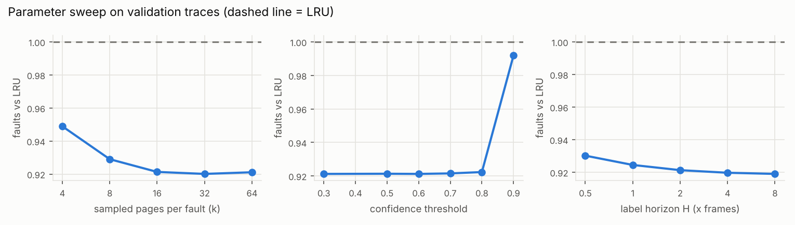

# A Lightweight Learned Page Replacement Policy for Operating System Memory Management

When memory is full, the operating system has to choose which page to evict.
Kernels use fixed rules such as LRU and CLOCK, which cause avoidable page faults
whenever the access pattern does not fit the rule's assumption (loops larger
than memory, one-time scans, skewed popularity). Belady's OPT makes the best
possible choice but needs to know the future.

This project learns from OPT offline and runs cheaply online. A tiny model
(logistic regression, 8 parameters) is trained to imitate OPT. At every page
fault it scores a handful of randomly sampled resident pages and evicts the
one least likely to be needed soon. Two LRU safety nets keep it from doing
much worse than LRU when the model is wrong.

Everything is in plain Python with NumPy: a trace-driven simulator, seven
baseline policies, the workload generators, the training pipeline, the
evaluation, the ablation study and the plots.

## Team

| S. No. | Name | Registration Number |
|---|---|---|
| 1 | Aryan Upadhyay | 24BCE2580 |
| 2 | Saharsh Indurkar | 24BCE2527 |
| 3 | Rajveer Singh Chopra | 24BCE0122 |

Vellore Institute of Technology

## Quick start

```bash
pip install -r requirements.txt

python -m mlpr textbook --steps      # FIFO 15, LRU 12, OPT 9 on the textbook string, step by step
python -m mlpr workloads             # the training / validation / test traces
python -m mlpr simulate --workload scan_hot --memory 0.05
python -m pytest                     # 37 tests
```

The repository ships with a trained model (`models/model.json`) and the
results it produced (`results/`). To reproduce everything from scratch:

```bash
python -m mlpr train       # learn from OPT, pick logistic vs tree on validation traces (~5 min)
python -m mlpr evaluate    # every policy on every unseen test trace -> results/summary.md + plots
python -m mlpr ablation    # which features and design choices matter
python -m mlpr sweep       # sample size k, confidence threshold, label horizon
# or: python -m mlpr all
```

Any trace can be simulated: `--trace-file pages.txt` (page numbers separated by
spaces or newlines) or `--msr web_0.csv.gz` for an MSR Cambridge volume.

## How it works



**Learning from OPT.** A training trace is replayed. At each eviction at time
`t`, 16 resident pages are sampled and each one gets a label from the future:
`y = 1` if its next use is more than `H = 2 x frames` references away ("not
needed soon"), else `y = 0`. OPT's future knowledge only appears in the labels,
never in the features. The first round replays with OPT itself. Two further
**DAgger** rounds replay with the trained model and still label with the
future, so the model also learns from the states its own mistakes lead to
(the idea behind Parrot [19]).

**Per-page features**, all known at fault time (24 bytes per page as a C struct):

| Feature | Meaning |
|---|---|
| `age` | references since the page was last used |
| `count` | references to the page so far |
| `gap1`, `gap2`, `gap3` | the last three gaps between its references |
| `mean_gap` | average gap |
| `age_over_mean_gap` | how overdue the page is compared with its usual gap |

Times are divided by the number of frames, so one model works at every memory
size. Values are capped and log-scaled. A gap not yet observed is censored:
the page has gone at least `age` references without reuse, so it is filled in
with the age. A page loaded a moment ago therefore looks hot, not cold. A
small **ghost table** keeps the metadata of the most recently evicted pages
(one entry per frame, like the shadow entries Linux uses to measure refault
distance), so a page that comes back keeps its history.

**Tiny model.** Logistic regression (7 weights + bias) and a depth-4 decision
tree are both trained. The one with fewer *simulated faults* on the validation
traces is kept, not the one with higher accuracy.

**Sampled eviction.** Only `k = 16` random resident pages are scored per fault,
so the cost is constant however many frames there are (LRB [18] uses the same
idea).

**Two safety nets** (following the robustness lesson of [20]):
1. *Confidence fallback*: if the best score is below the threshold, the model is
   unsure and the least recently used page of the sample is evicted.
2. *Regret guard*: a shadow LRU directory (page numbers only) counts the faults LRU
   would have taken. If over a window of `max(1000, 8 x frames)` references the
   learned policy faulted more than 2% above that, eviction is handed to exact
   LRU for a number of windows that doubles on every losing retry and halves
   on every winning window.

## What is implemented

| Policy | File | Notes |
|---|---|---|
| FIFO | `mlpr/policies/fifo.py` | |
| LRU | `mlpr/policies/lru.py` | |
| LFU | `mlpr/policies/lfu.py` | ties broken by recency, O(log n) heap |
| CLOCK | `mlpr/policies/clock.py` | second chance, what kernels approximate LRU with [10] |
| ARC | `mlpr/policies/arc.py` | Megiddo and Modha [8] |
| LeCaR | `mlpr/policies/lecar.py` | learned baseline: regret-weighted LRU vs LFU [14] |
| OPT | `mlpr/policies/opt.py` | Belady [1], lower bound and teacher |
| **Learned** | `mlpr/policies/learned.py` | this project |

| Module | Role |
|---|---|
| `mlpr/simulator.py` | trace-driven simulator, times every fault |
| `mlpr/traces/` | synthetic patterns, program-derived traces, MSR loader |
| `mlpr/workloads.py` | train / validation / test split, memory sizes |
| `mlpr/features.py` | per-page metadata, ghost table, feature extractor |
| `mlpr/models.py` | logistic regression (Newton's method) and CART tree, NumPy only, saved as JSON |
| `mlpr/training.py` | OPT replay, labelling, DAgger rounds, model selection |
| `mlpr/experiments.py`, `mlpr/plots.py` | evaluation, ablation, sweeps, tables and figures |
| `mlpr/__main__.py` | command line interface |

## Workloads

Every family appears in three splits with different seeds and parameters.
Models are trained on `train`, chosen and tuned on `validation`, and reported
only on the unseen `test` traces.

| Workload | Type | What it tests |
|---|---|---|
| `loop` | synthetic | loop larger than memory: LRU's worst case |
| `zipf` | synthetic | skewed popularity: frequency matters more than recency |
| `phase` | synthetic | the working set shifts over time |
| `scan_hot` | synthetic | one-time scans flushing a hot set |
| `mixed` | synthetic | a looping program and a Zipf program sharing memory |
| `matmul` | program | naive i-j-k matrix multiply (column walks of B) |
| `mergesort` | program | bottom-up merge sort: streaming, where no gain is expected |
| `bfs` | program | breadth-first search over a graph in CSR form |
| `msr_*` | real | MSR Cambridge block I/O [11], if placed in `data/msr/` (see there) |

Program traces come from running the algorithms and recording the address of
every array element they touch. The page size is scaled down to 64 bytes so
that inputs small enough for Python still span hundreds to thousands of
pages. Memory sizes are 1%, 2%, 5% and 10% of each trace's distinct pages
(at least 8 frames).

## Results

All numbers below come from `python -m mlpr evaluate` on the **unseen test
traces** (full tables: [`results/summary.md`](results/summary.md), raw data:
[`results/results.csv`](results/results.csv)).

| Workload | ARC reduction | LeCaR reduction | **Learned reduction** | ARC gap closed | LeCaR gap closed | **Learned gap closed** |
|---|---|---|---|---|---|---|
| loop | 1.9 | 0.0 | 0.0 | 30.7 | -0.1 | 0.1 |
| zipf | 16.8 | 18.6 | 18.0 | 47.8 | 52.2 | 50.5 |
| phase | 7.8 | 11.2 | **11.4** | 22.3 | 27.6 | **29.7** |
| scan_hot | 13.5 | 10.0 | 12.7 | 46.3 | 34.8 | 45.2 |
| mixed | 12.3 | 11.4 | 7.6 | 61.1 | 56.8 | 38.0 |
| matmul | 7.8 | 3.6 | 2.3 | 32.5 | 16.3 | 17.5 |
| mergesort | 0.0 | -0.2 | 0.0 | -0.4 | -4.2 | 0.0 |
| bfs | 0.0 | 1.7 | **14.1** | -0.4 | 3.6 | **34.5** |
| **all** | 7.5 | 7.0 | **8.3** | **33.8** | 29.8 | 33.3 |

Values in %. Reduction = fewer faults than LRU, averaged over the four memory
sizes. Gap closed = share of the LRU-to-OPT gap closed, on faults summed over
the memory sizes.





**What the numbers say**

* Over all test traces the learned policy takes **8.3% fewer faults than LRU**,
  slightly ahead of ARC (7.5%) and LeCaR (7.0%), and closes a third of the
  LRU-to-OPT gap, on par with ARC.
* It wins clearly where the useful signal is the *gap history* of a page:
  `bfs` (14.1% fewer faults than LRU, while ARC and LeCaR gain almost nothing)
  and `phase` (best of all policies). On `zipf` and `scan_hot` it is level with
  the best adaptive baseline.
* It does **not** help on `loop`: a loop larger than memory brings every page
  back after the ghost table has already forgotten it, so all resident pages
  look alike and the policy behaves like LRU. The same costs it ground on
  `mixed`, half of which is a loop. ARC does better there.
* `mergesort` streams through memory and every policy is within 0.5% of OPT;
  the learned policy matches LRU, as expected.
* Worst case: 8.9% more faults than LRU on `matmul` at 10% memory, where LRU is
  already within 0.5 percentage points of OPT. On every other trace and
  memory size it is better than LRU or within 0.02% of it. The guard handed
  3.7% of all evictions to LRU.

**Cost.** The model is 8 numbers (32 bytes). Each fault scores 16 pages with 7
features each, a fixed amount of work whatever the memory size. The metadata
is 24 bytes per resident page, plus 32 bytes per ghost entry and 48 bytes per
frame for the guard. In this Python simulator a learned decision takes about
58 µs against 0.4 µs for LRU, but that is almost entirely NumPy call overhead
on 16-row arrays; the arithmetic itself is a few hundred multiply-adds.
Training takes about 2.5 minutes on 2.9 million examples.



### Ablation and parameter sweep

Run on the validation traces (`python -m mlpr ablation`, `python -m mlpr sweep`;
tables in [`results/ablation_and_sweep.md`](results/ablation_and_sweep.md)).
Score = learned faults / LRU faults, averaged over traces and memory sizes.



* **Which signals explain OPT's choices.** Reference count is the most important
  feature (removing it: 0.983 → 1.115), followed by how overdue a page is
  compared with its usual gap (`age_over_mean_gap`: → 1.003). The individual
  gaps, the mean gap and the age each overlap with the others, so dropping any
  one of them alone changes little. No group works on its own: recency only
  (2.51) or frequency only (2.16) is far worse than LRU, and gap history only is
  1.03. It is the combination that beats LRU.
* **Design choices.** The regret guard turns the same model from 0.983 into
  0.921. The two DAgger rounds are worth 0.959 → 0.921 and the ghost table
  0.971 → 0.921. The depth-4 tree (46 parameters) scores 0.935, behind
  logistic regression (8 parameters), so the simpler model was kept.



* **k** (pages sampled per fault): 4 → 0.949, 8 → 0.929, 16 → 0.921, and no
  gain beyond that, so `k = 16` is the knee.
* **Confidence threshold**: flat up to 0.8. At 0.9 the fallback takes almost
  every decision and the policy becomes LRU-like (0.992). With the default 0.5
  the fallback almost never fires; the guard does the safety work.
* **Label horizon H**: from 0.5 to 8 × frames the score moves only from 0.930 to
  0.919, so the method is not sensitive to it. The default stays at 2.

## Evaluation parameters

* Fault rate and hit ratio, per trace and memory size
* Fault reduction vs LRU = (F_LRU − F_policy) / F_LRU × 100
* Gap closed = (F_LRU − F_policy) / (F_LRU − F_OPT) × 100
* Worst case vs LRU: the most extra faults on any trace and memory size
* Decision time per fault, metadata per page, model size, training time
* Everything above on unseen test traces only

## Limitations and next steps

* Decision times come from a Python simulator. They rank policies against each
  other, but a C implementation of the final policy (on top of the OS lab code)
  is needed for kernel-realistic overhead numbers.
* The MSR traces are not bundled (licence); the loader and evaluation hook are
  ready for them.
* Program traces use a scaled-down page size.
* The model is trained once, offline. Retraining periodically on recent history,
  labelled by OPT over the past window as Hawkeye [13] does, is the stretch goal.

## References

Numbering follows the project's literature survey.

* [1] L. A. Belady, "A study of replacement algorithms for a virtual-storage computer," IBM Systems Journal, vol. 5, no. 2, pp. 78–101, 1966.
* [8] N. Megiddo and D. S. Modha, "ARC: A self-tuning, low overhead replacement cache," in Proc. USENIX FAST, 2003, pp. 115–130.
* [10] S. Jiang, F. Chen, and X. Zhang, "CLOCK-Pro: An effective improvement of the CLOCK replacement," in Proc. USENIX ATC, 2005, pp. 323–336.
* [11] D. Narayanan, A. Donnelly, and A. Rowstron, "Write off-loading: Practical power management for enterprise storage," in Proc. USENIX FAST, 2008, pp. 253–267.
* [13] A. Jain and C. Lin, "Back to the future: Leveraging Belady's algorithm for improved cache replacement," in Proc. ISCA, 2016, pp. 78–89.
* [14] G. Vietri et al., "Driving cache replacement with ML-based LeCaR," in Proc. USENIX HotStorage, 2018.
* [18] Z. Song, D. S. Berger, K. Li, and W. Lloyd, "Learning relaxed Belady for content distribution network caching," in Proc. USENIX NSDI, 2020, pp. 529–544.
* [19] E. Z. Liu, M. Hashemi, K. Swersky, P. Ranganathan, and J. Ahn, "An imitation learning approach for cache replacement," in Proc. ICML, PMLR vol. 119, 2020, pp. 6237–6247.
* [20] T. Lykouris and S. Vassilvitskii, "Competitive caching with machine learned advice," Journal of the ACM, vol. 68, no. 4, Art. 24, 2021.
